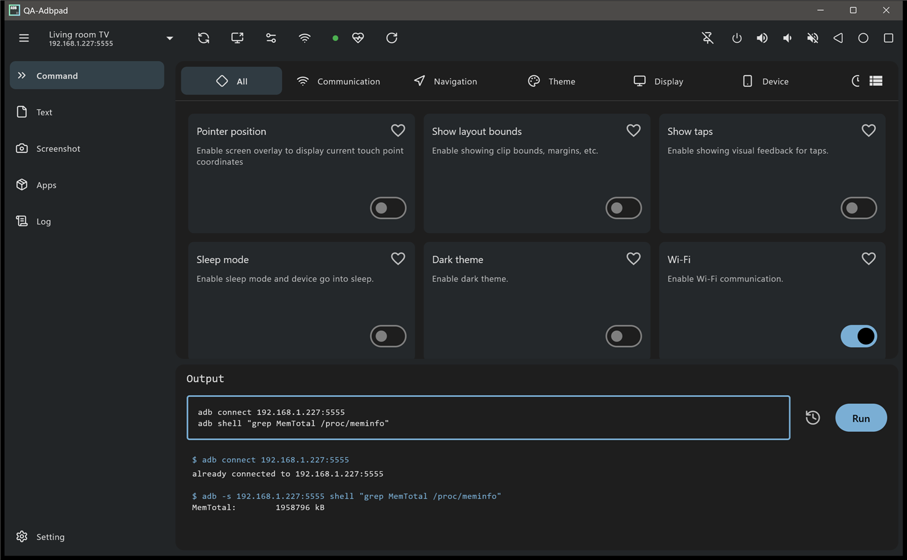
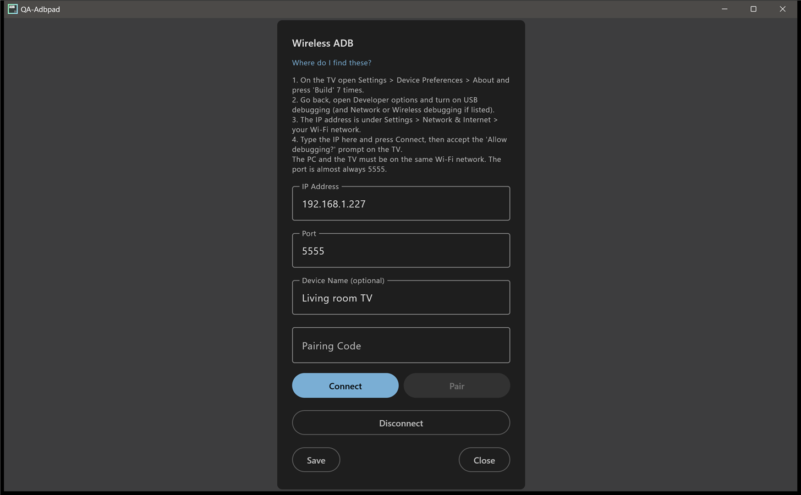
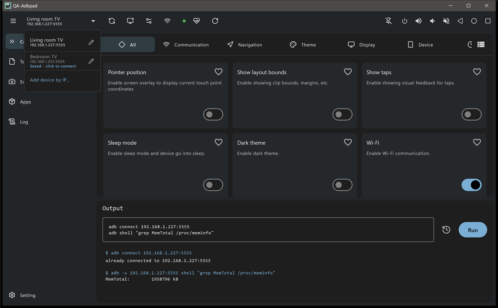

#  QA-Adbpad

A desktop app for testing on Android and Android TV devices without a terminal. Type the
device's IP address, press Connect, and take screenshots, mirror the screen, capture logs and
change device settings with a click.

adb and scrcpy are built in. There is nothing else to install or configure.



## Download

Get the file for your system from the [latest release](https://github.com/TonciZ/QA-Adbpad/releases/latest).

| System                              | File                                   |
| ----------------------------------- | -------------------------------------- |
| Windows                             | `QA-Adbpad-<version>.msi`              |
| macOS, Apple Silicon (M1 and newer) | `QA-Adbpad-<version>-macos-arm64.dmg`  |
| macOS, Intel                        | `QA-Adbpad-<version>-macos-x64.dmg`    |
| Linux, Ubuntu / Debian              | `QA-Adbpad-<version>-linux-x64.deb`    |
| Linux, any other distribution       | `QA-Adbpad-<version>-linux-x64.tar.gz` |

> [!NOTE]
> Development and testing happen on Windows. The macOS and Linux builds are produced
> automatically and have had little real-world use. Please
> [open an issue](https://github.com/TonciZ/QA-Adbpad/issues) if something does not work.

- **macOS:** the app is not signed. The first time, right-click the app and choose **Open**, or
  allow it under System Settings > Privacy & Security.
- **Linux `.tar.gz`:** unpack it and run `QA-Adbpad/bin/QA-Adbpad`.

## Connect a device

1. On the device, turn on **Developer options** and **USB debugging** (and **Network** or
   **Wireless debugging** if it is listed).
2. In QA-Adbpad, open the device list at the top left and choose **Add device by IP...**
3. Type the device's IP address and press **Connect**. Accept the "Allow debugging?" prompt on
   the device.

The dialog has a **Where do I find these?** link with the same steps in more detail. The computer
and the device must be on the same network.



Devices you connect are remembered. Next time, pick one from the list to reconnect, or use the
pencil to change its IP address or name.



## What you can do

- **Screenshots** - one click, saved with the device name. Works on Android TV boxes where many
  tools return empty files.
- **Screen mirroring** (scrcpy) - with Low-end / Mid-range / High-end quality presets and a scanner that finds
  settings that work on devices that freeze with the defaults.
- **Logs** - start, reproduce the problem, stop. Search and filter by level, then save
  everything or only what is shown. The file name includes the device and the time.
- **Device settings** - switches for Wi-Fi, Bluetooth, airplane mode, dark theme, layout bounds
  and more. They show the device's real current state.
- **Send text** - type on the computer instead of with a TV remote.
- **Your own adb commands** - paste one or several lines such as
  `adb shell "grep MemTotal /proc/meminfo"` into the Output box and press Enter. Earlier commands
  are kept in a history.
- **Remote keys** - power, volume, back, home and recents in the toolbar.
- **Device health** - check whether a device is really responding, and restart it.

## Updating

From version 1.6.2 the app checks for a new version when it starts and shows an **Update now**
banner.

- **Windows:** the update installs itself and the app reopens. Windows may ask once for
  permission.
- **macOS:** the new disk image is downloaded and opened. Drag the app to Applications.
- **Linux:** the download page opens.

Versions before 1.6.2 cannot download updates. Install the latest version once by hand.

## Using your own adb or scrcpy

Not needed. If you prefer your own copies, set their paths in **Settings > SDK**. Leave the
fields empty to use the built-in ones.

## For developers

```bash
./gradlew run          # run from source
./gradlew test         # tests
./gradlew ktlintCheck  # code style
./gradlew packageMsi   # Windows installer (packageDmg / packageDeb on macOS / Linux)
```

Releases are built by the **Release** workflow in GitHub Actions. [CHANGES.md](CHANGES.md)
explains what this fork changed from upstream and why.

## Credits and license

QA-Adbpad is a fork of [AdbPad](https://github.com/kaleidot725/adbpad) by
[kaleidot725](https://github.com/kaleidot725), reworked for testing Android TV devices.
It bundles [scrcpy](https://github.com/Genymobile/scrcpy) (Apache License 2.0), which includes
adb from the Android SDK Platform Tools.

MIT License. Copyright (c) 2025 Yusuke Katsuragawa. Modifications copyright (c) 2026 TonciZ.
See [LICENSE](LICENSE).
